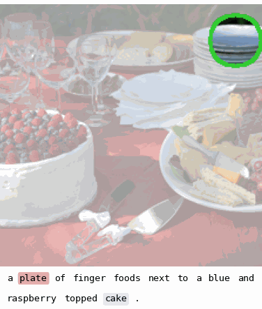

# GEFI
This repository provides the implementation of **Gradient-Estimation-Based Feature Interaction (GEFI)**, along with the code required to reproduce the main experimental results presented in our paper:
> "**Cross-Modal Model Behavior with Gradient-Estimation-Based Feature**". \
> _Yi Cai, Xinpeng Li, and Gerhard Wunder_, Accepted at the 40th Conference on Neural Information Processing Systems (NeurIPS 2026).

  <strong>Visualizing Cross-Modal Feature Interactions with GEFI-PM</strong> 
   &nbsp; &nbsp; 

GEFI is a black-box explainability framework for quantifying higher-order feature interactions in machine learning models. 
It extends [GEFA](https://openreview.net/pdf?id=QyG0ilz5ju) (ICML'25) from first-order feature attribution to higher-order interactions, providing a general formulation based on proxy gradient estimation with a theoretically established equivalence to the **Shapley Interaction Index (SII) at arbitrary orders**.

This repository specifically implements **GEFI-PM**, a computationally efficient variant derived from the general GEFI framework and tailored to investigating cross-modal feature interactions in CLIP-like dual-encoder models.
By exploiting the product-measure structure of image and text representations, GEFI-PM enables efficient utilization of model observations and highly parallelizable interaction estimation. 
These computational advantages allow GEFI-PM to deliver fine-grained, pixel-level interation resutls, going beyond the fixed image patches commonly considered in the existing literature.

### Key Features

- **Black-box explainability:** Estimates feature interactions using model input-output observations without requiring access to internal gradients or model parameters.
- **Efficient cross-modal estimation:** GEFI-PM leverages the product-measure structure of dual encoders to improve estimation efficiency under limited query budgets.
- **Fine-grained explanations:** Supports pixel-level image-text interactions and flexible region-based anchors, including bounding boxes and segmentation masks.